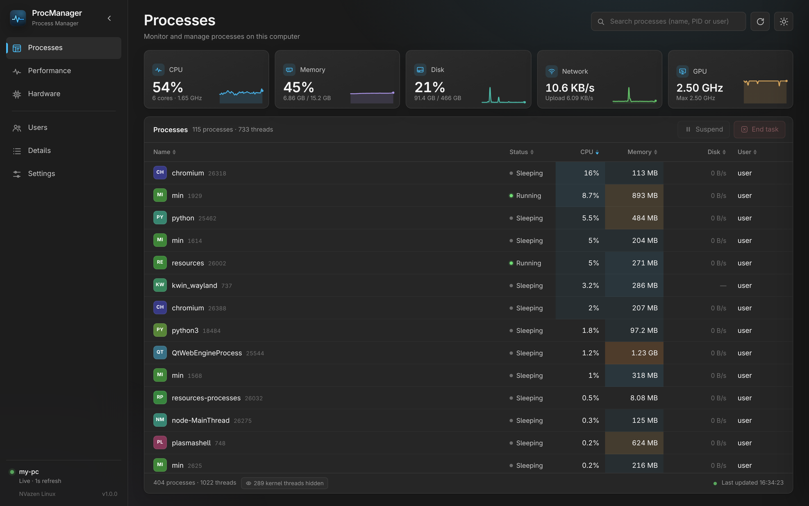
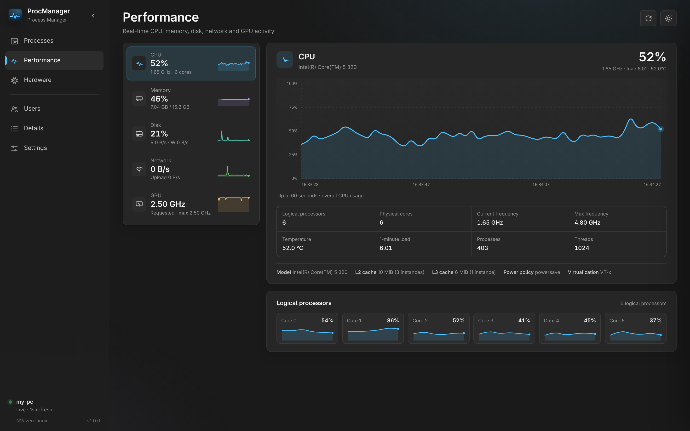
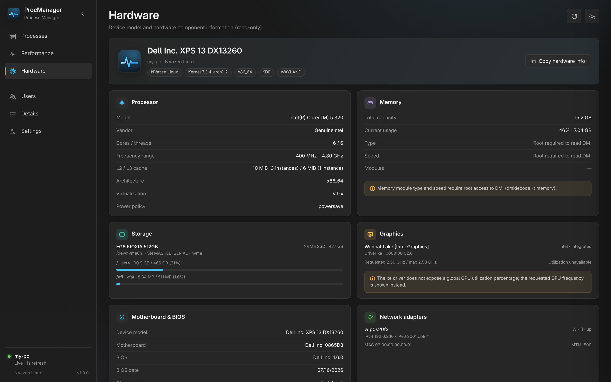
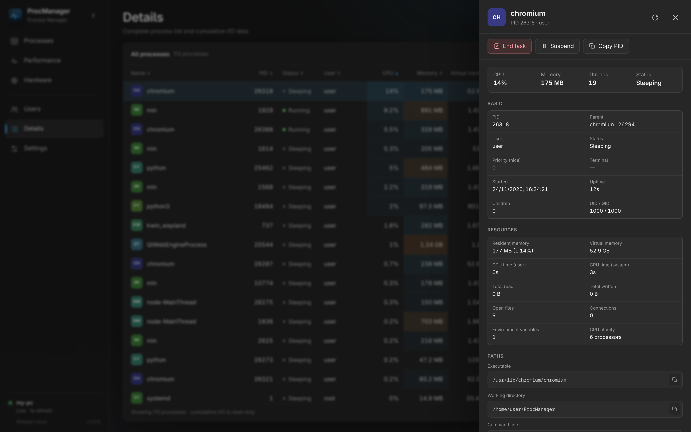
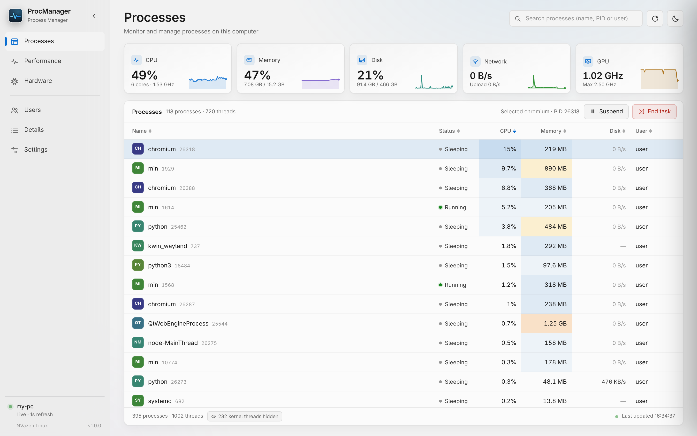

# ProcManager

A Windows 11 Task Manager–inspired process and system monitor for Linux.
ProcManager monitors processes, CPU, memory, disks, networking and GPUs, and
shows hardware details — while being explicit about the data it cannot read.

It ships as a local web UI with three launch styles:

* **Native PyQt6 window** (preferred) — a true Qt window using the
  project-local, self-consistent `.venv-native` environment.  A compatible
  system PyQt6/Qt WebEngine installation is used when no venv is present.
* **Chromium app window** — fallback when native Qt is unavailable, with no
  tabs or address bar.
* **Browser mode** — always available.

The backend binds to `127.0.0.1` only, requires a per-run token for process
actions, and never sends telemetry anywhere.



## Features

### Processes
* Live process table with CPU (percent of total machine CPU), memory,
  disk I/O, user and state.
* Search by name, PID, user or state; sortable columns.
* Per-process CPU/memory heat highlighting similar to Task Manager.
* End task (`SIGTERM`), force end (`SIGKILL`), suspend/resume
  (`SIGSTOP`/`SIGCONT`).
* Confirmation dialog, protection for PID 1/2 and ProcManager itself,
  PID-reuse protection via process creation time.
* Full process drawer: command line, working directory, parent/children,
  memory breakdown, CPU times, cumulative I/O, open files, connections.
* Details tab with cumulative I/O and start time for every process.
* Kernel threads hidden by default with a one-click toggle.

### Performance
* CPU: total and per-core graphs, frequency, temperature, load average,
  per-core history.
* Memory: physical usage, available, cache, buffers, shared memory, swap,
  plus a live graph.
* Disk: read/write throughput and IOPS, per-partition usage, hardware model.
* Network: download/upload throughput, per-interface addresses, link state.
* GPU: dynamic metrics when the driver exposes them.
* Summary cards on the process page link straight to the selected resource.

### Hardware
* CPU model, cores/threads, frequency range, caches, virtualization,
  governor.
* DMI machine/board/BIOS details.
* Physical disks, NVMe/SATA/HDD type, serial, filesystem usage.
* GPU name/PCI/driver/frequency; NVIDIA and AMD dynamic metrics where
  available.
* Network interfaces, IPv4/IPv6, MAC, MTU.
* Battery state, remaining time and power draw (when exposed by the
  kernel).
* Copy all hardware information to the clipboard.

### Users & details
* Sessions grouped by user with aggregated CPU, RSS and process/thread
  counts.
* Service accounts listed separately; kernel threads summarised separately.
* Full details table with search and sorting.

### Appearance & behavior
* Fully English interface (en-AU date and time formatting).
* Fluent-inspired dark and light themes, Mica-like background, rounded
  cards and Segoe/Noto fonts.
* Collapsible sidebar (automatic on narrow windows).
* Adjustable UI refresh interval (1 s / 2 s / 5 s); sampling is fixed at 1 s.
* Keyboard shortcuts: `Ctrl+F` search, `Enter` details, `Delete` end task,
  `F5` refresh, `Esc` close overlays, `Ctrl+1…6` switch pages.
* Persistent settings via `localStorage`.

| Performance | Hardware |
| --- | --- |
|  |  |

| Process details | Light theme |
| --- | --- |
|  |  |

## Quick start

Requirements: Linux, Python 3.10+, and [psutil]. A recent Chromium (or any
browser) provides a fallback window.  The optional native Qt window is set up
with a project-local virtual environment.

```bash
git clone https://github.com/AzenDev2026/ProcManager.git
cd ProcManager
python3 -m pip install -r requirements.txt

# optional but recommended: native Qt window with an isolated PyQt6 stack
./scripts/setup-native-window.sh

python3 run.py
```

`run.py` chooses a mode automatically:

1. the project-local `.venv-native` (auto re-exec) when it exists and works;
2. a compatible system PyQt6/Qt WebEngine installation;
3. a Chromium app window;
4. the default browser.

Run a specific mode:

```bash
python3 run.py --app                     # Chromium app window
python3 run.py --web --no-browser        # browser UI on port 8765
python3 run.py --web --port 9000         # custom port
python3 run.py --desktop                 # try native PyQt6 window
```

The actual local URL is printed on startup. App windows default to port
`8766` (falling back to a random free port if it is busy); browser mode
defaults to `8765`. A stable app port keeps theme and preferences in
`localStorage` across launches.

### Install a desktop launcher

```bash
./scripts/install-desktop.sh
# optional: also add a shortcut on the desktop
./scripts/install-desktop.sh --desktop-shortcut
```

This writes `procmanager.desktop` to `~/.local/share/applications`. The
launcher requests the native window; `run.py` automatically uses
`.venv-native` when present and falls back to the Chromium app window if the
Qt stack is unavailable. Remove that file to uninstall the launcher.

### Native PyQt6 window

```bash
./scripts/setup-native-window.sh
```

The script creates `ProcManager/.venv-native` containing a known-good,
mutually compatible set: **PyQt6 6.11.0, PyQt6-Qt6 6.11.2,
PyQt6-WebEngine 6.11.0 and PyQt6-WebEngine-Qt6 6.11.2**, plus psutil.  The
venv is fully isolated from the system Python and from other projects, so
installing it does not change their PyQt6 packages.  `run.py` automatically
re-execs into this venv for auto/`--desktop` launches; `--web` and `--app`
stay in the current interpreter.

The native window is a `QMainWindow` with the same local UI.  It remembers
theme/preferences because it always uses port `8766` (origin-stable
`localStorage`), while browser mode uses `8765`.

The native window renders the same interface shown in the screenshots above; it
uses a standard Qt title bar instead of a browser frame.

## Data accuracy

ProcManager deliberately shows `—` (unavailable) rather than inventing values.
The main data sources are `psutil`, `/proc`, `/sys`, `lscpu`, `lsblk`, `lspci`,
`nvidia-smi`, and DMI.

| Metric | Source / semantics | Caveats |
| --- | --- | --- |
| Process CPU | `psutil` CPU times delta over the sampling interval, divided by logical CPU count | Displayed as a percentage of the whole machine, like Windows Task Manager. First sample after start is 0. |
| System CPU | `psutil.cpu_percent(percpu=True)`; overall is the mean of logical cores | Sampling is 1 s. |
| Memory | `psutil.virtual_memory()` | The summary percentage and “in use” use `total - available`; the detailed view also shows cache/buffers. |
| User memory | Sum of process RSS | Shared pages are counted once per process, so user totals can be higher than system-wide usage. Disclosed in the UI. |
| Per-process disk I/O | `/proc/[pid]/io` via psutil | Readable only for the same user (or root); restricted processes show `—`. |
| Disk capacity | `psutil.disk_usage()` per mount point | Filesystem size can differ slightly from the raw partition size. |
| Disk throughput | `/proc/diskstats` via psutil deltas | Machine-wide, not per process. |
| Network | `/proc/net/dev` via psutil deltas | Loopback excluded. Wi‑Fi adapters often do not expose a link speed. |
| GPU utilization | nvidia-smi / amdgpu sysfs | Intel Xe/i915 does not expose a global utilization percentage; ProcManager shows the requested GPU frequency instead and labels it clearly. |
| GPU memory | nvidia-smi / amdgpu sysfs | Integrated GPUs share system memory and usually expose no dedicated VRAM. |
| Memory type/speed | DMI type 17 through `dmidecode` | Requires root. Without it the fields are displayed as “needs root”, not guessed. |
| Hardware models | `lscpu`, DMI, `lsblk`, `lspci`, nvidia-smi | Values are presented as reported by the kernel/tools. |

Units on screen use 1024-based KB/MB/GB (matching Windows Task Manager).
Tooltips and the API expose exact byte counts. The backend rounds display
values but not the underlying counters.

The web UI and JSON API are local-only. Mutating requests additionally require
the per-run token injected into the page and are rejected when the `Origin` or
`Sec-Fetch-Site` headers look cross-site. PID 1, PID 2, and the ProcManager
backend are protected from termination; PID reuse is detected using process
creation time.

## Architecture

```
ProcManager/
├── run.py                     launcher: auto / --app / --web / --desktop
├── procmanager/
│   ├── system_info.py         static CPU, DMI, disks, GPU, network collection
│   ├── sampler.py             1 s sampling thread, history ring buffer, actions
│   ├── server.py              local HTTP server, JSON API, token/origin checks
│   ├── desktop.py             optional native PyQt6 WebEngine window
│   └── web/                   index.html, app.js, styles.css, boot.js
├── assets/icon.svg
├── requirements-native.txt    pinned, compatible PyQt6/Qt WebEngine set
├── scripts/
│   ├── setup-native-window.sh create the isolated .venv-native Qt environment
│   └── install-desktop.sh     native-first desktop launcher
├── tests/test_api.py          stdlib unittest coverage for API + security + actions
└── docs/screenshots/
```

The sampler runs in a daemon thread and publishes immutable snapshots. HTTP
handlers read the latest snapshot, so multiple clients and slow browsers do not
slow down sampling. The front end keeps a 60 s client-side history for charts;
the backend keeps a 300 s ring buffer that is used to prefill charts.

## Development

```bash
python3 -m unittest discover -s tests -v
```

The suite covers data accuracy against psutil, static asset/CSP headers, token
and origin protection, Host validation, path traversal, protected PIDs, and
real terminate/suspend/resume actions against disposable `sleep` processes.

Manual UI testing was performed with Chromium/Playwright at 1440×900 and
responsive sizes 1280/1024/900, including light/dark themes, actions, drawer,
search and keyboard shortcuts.  The native Qt window was verified separately
on Wayland (Qt 6.11.2): the window loads the complete UI and every API request
succeeds.

## Limitations

* Linux only. Windows/macOS process and hardware discovery is not implemented.
* No per-process network usage (Linux does not expose this cheaply and
  accurately).
* No application grouping/subprocess trees in the process table.
* GPU support is best-effort: Intel Xe exposes frequency but not global
  utilization; some drivers expose neither.
* Ending root-owned processes requires running ProcManager as root; the UI
  reports the permission error instead of pretending to succeed. When run as
  root, ProcManager automatically serves the browser UI instead of starting a
  root Chromium window; open the printed URL in your normal browser.
* DMI memory type/speed requires root.
* No service/startup-app management tabs.
* The native Qt window is preferred when `.venv-native` exists; without a
  compatible PyQt6 stack ProcManager falls back to the Chromium app window.

## License

No license has been chosen for this project yet.

[psutil]: https://github.com/giampaolo/psutil
